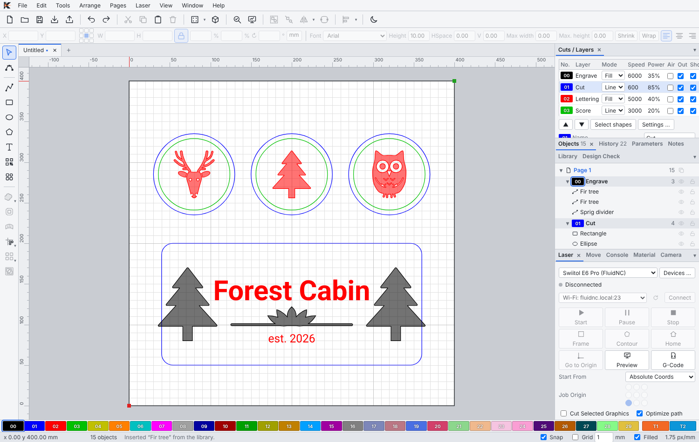
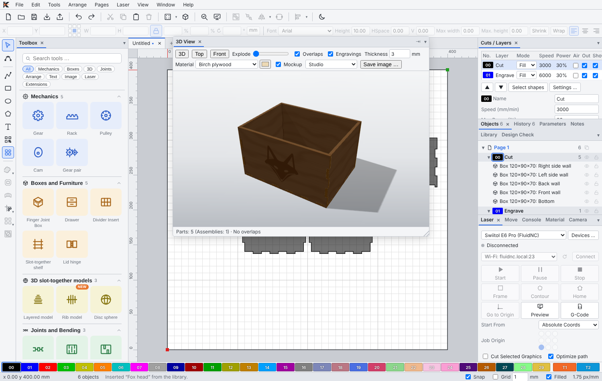
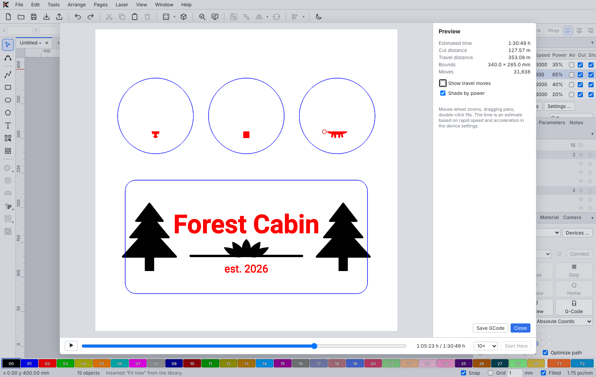

<p align="center">
  <picture>
    <source media="(prefers-color-scheme: dark)" srcset="docs/brand/kizamubeam-logo-dark.png">
    
  </picture>
</p>

<p align="center">
  <b>Progetta, incidi, taglia. Software laser libero per macOS, Windows e Linux.</b>
</p>

<p align="center">
  <a href="https://github.com/negurvulkan/kizamubeam/releases"><b>Download</b></a> ·
  <a href="https://negurvulkan.github.io/kizamubeam/it/">Sito web</a> ·
  <a href="docs/features.it.md">Tutte le funzioni</a> ·
  <a href="https://discord.gg/SSr8VHh7EJ">Discord</a> ·
  <a href="README.md">English</a> ·
  <a href="README.de.md">Deutsch</a>
</p>

KizamuBeam ti accompagna dalla prima idea al pezzo finito in un’unica app: disegna e scrivi direttamente sull’area di lavoro, trasforma le foto in incisioni, genera scatole, ingranaggi e modelli a incastro, controlla tutto in 3D e invia il lavoro direttamente al tuo laser. Se hai già usato LightBurn, ti sentirai subito a casa.

È open source (GPL-3.0), gratuito e non richiede account né chiavi di licenza.

<p align="center">
  
</p>

## Download

| Sistema | File |
|---|---|
| **macOS** (Apple Silicon e Intel) | `KizamuBeam_…_universal.dmg` |
| **Windows** (64 bit) | `KizamuBeam_…_x64-setup.exe` |
| **Linux** (64 bit) | `KizamuBeam_…_amd64.AppImage`, `.deb` o `.rpm` |

Scarica l’ultima versione dalla [pagina delle release](https://github.com/negurvulkan/kizamubeam/releases) o dal [sito web](https://negurvulkan.github.io/kizamubeam/it/#download). Versione attuale: **2.8.0** (stabile). Una volta installato, KizamuBeam si aggiorna da solo (Aiuto → Controlla aggiornamenti).

> **Primo avvio su macOS:** se macOS dice che l’app non può essere verificata, apri Impostazioni di Sistema → Privacy e sicurezza e fai clic su “Apri comunque”.

## Cosa puoi fare

### Disegnare direttamente nell’app
Linee, curve, forme e testo con qualsiasi font, compresi tutti i Google Fonts con un clic. Combina le forme, crea offset, modifica i nodi (anche su più oggetti insieme), semplifica e leviga i percorsi, piega il testo lungo un percorso, arrotonda gli angoli. Aggancio, allineamento, array e nesting automatico mantengono tutto in ordine, e ogni risultato resta una curva pulita e modificabile. Una libreria con **400 motivi ed elementi decorativi integrati** ti aiuta a iniziare.

### Portare dentro i tuoi disegni
Apri file SVG, DXF, PDF e Illustrator, progetti LightBurn (`.lbrn2`) e tutti i formati di immagine più comuni. Le foto ottengono retinatura (dithering), effetti giornale e schizzo, rimozione dello sfondo, ritaglio e maschere, e possono essere ricalcate in vettori, comprese le linee centrali per l’incisione a tratto singolo.

### Generare le parti invece di disegnarle
Inserisci le misure e ottieni parti finite: **scatole con giunzioni a dita, cassetti, divisori, scaffali, ingranaggi, cremagliere, pulegge, camme e cerniere per coperchi**. Giunzioni, fessure e cerniere flessibili si possono aggiungere a qualsiasi forma. Trasforma modelli 3D (STL/OBJ) in modelli a strati, a costole o a dischi fatti di parti piane. Più tardi basta un doppio clic su una parte per modificarla, e tutto si ricalcola.

<p align="center">
  
</p>

### Vedere prima di bruciare
La **vista 3D** monta le parti esattamente come verranno assemblate, con materiale, texture e incisioni, e mostra se qualcosa si scontra. Il **controllo del progetto** trova forme aperte, dettagli troppo piccoli e problemi di accoppiamento prima di iniziare. L’**anteprima** riproduce il lavoro con una stima precisa del tempo.

<p align="center">
  
</p>

### Far lavorare il tuo laser
Funziona con **FluidNC, GRBL, grblHAL, Marlin e Smoothieware**, via USB o Wi-Fi. Una procedura guidata rileva il controller, ne controlla le impostazioni ed esegue un primo lavoro di prova. Frame, avvio, pausa, regolazione di potenza e velocità durante l’incisione, partenza da un punto qualsiasi del lavoro. Prima di ogni lavoro KizamuBeam controlla che tutto stia sul piano. Sono supportati accessori rotary, asse Z motorizzato e assistenza aria.

### Trovare le impostazioni giuste
Una libreria materiali conserva le impostazioni collaudate. Test del materiale, test di messa a fuoco e una calibrazione dell’accoppiamento aiutano a trovarle, e un test può essere valutato direttamente da una foto. Per livello: più passate, sottolivelli, ponticelli, compensazione del kerf, perforazione, entrate e rampe di potenza.

### Produrre in serie
Modelli con parametri, testo variabile e numeri di serie da CSV, codici QR e codici a barre, progetti su più pagine, dime per serie di pezzi grezzi, **Print and Cut** con segni di registro e una fotocamera per posizionare i disegni direttamente sul pezzo.

### Renderlo tuo
Finestre agganciabili e barre degli strumenti personalizzabili, tema chiaro e scuro, interfaccia in italiano, inglese e tedesco. La Casella degli strumenti raccoglie tutti i generatori e gli strumenti speciali in un unico posto. Le estensioni aggiungono profili di dispositivo, modelli, materiali e motivi. Impostazioni, dispositivi e librerie si possono salvare o trasferire come file, oppure sincronizzare tra computer tramite una tua cartella (iCloud, Dropbox, Nextcloud). Agenti IA come Claude Code o Codex possono lavorare sul tuo progetto tramite il server MCP integrato, con il livello di accesso che scegli tu.

**→ [L’elenco completo delle funzioni](docs/features.it.md)**

## Compilarlo da te

Servono Node.js 20+ e Rust (stable); su Linux anche i [prerequisiti di Tauri](https://v2.tauri.app/start/prerequisites/).

```bash
npm install
npm run tauri dev      # app desktop con ricaricamento dal vivo
npm run tauri build    # programma di installazione per il tuo sistema
```

Release, aggiornamenti, traduzioni e struttura del codice sono descritti nella [guida per sviluppatori](docs/development.md) (in inglese). I contributi sono benvenuti.

## Community

Domande, idee o qualcosa che hai realizzato con KizamuBeam? Unisciti a noi su [Discord](https://discord.gg/SSr8VHh7EJ). Bug e richieste di funzioni vanno segnalati preferibilmente come [issue su GitHub](https://github.com/negurvulkan/kizamubeam/issues).

## Licenza

KizamuBeam è software libero distribuito con la [GNU General Public License v3.0 o successiva](LICENSE). Realizzato con Tauri 2, TypeScript e Rust. “Kizamu” (刻む) in giapponese significa intagliare, incidere, tagliare finemente.

Copyright © 2026 [Hanjo Winter](https://github.com/negurvulkan). Sviluppato con l’aiuto di [Claude Code](https://claude.com/claude-code).

## Marchi

LightBurn è un marchio di LightBurn Software, LLC. KizamuBeam è un progetto indipendente e non è affiliato né approvato da LightBurn Software.
